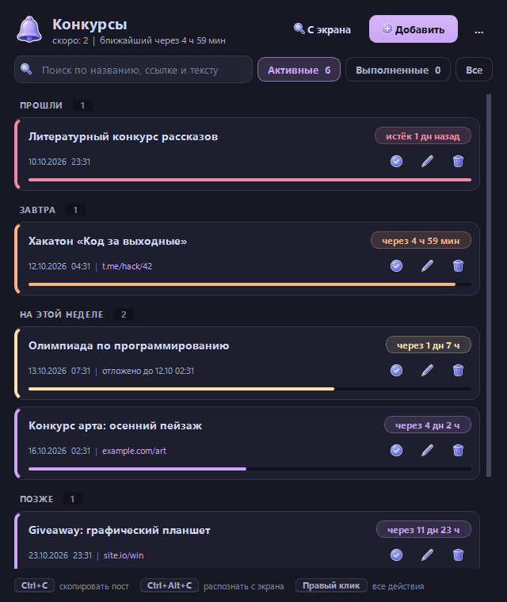
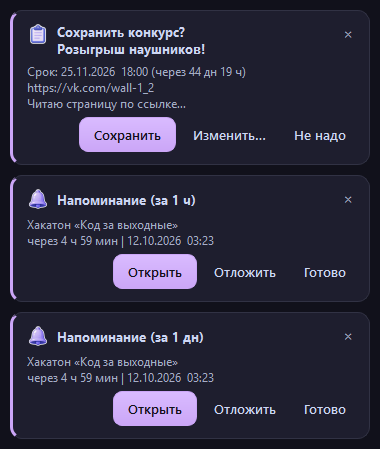
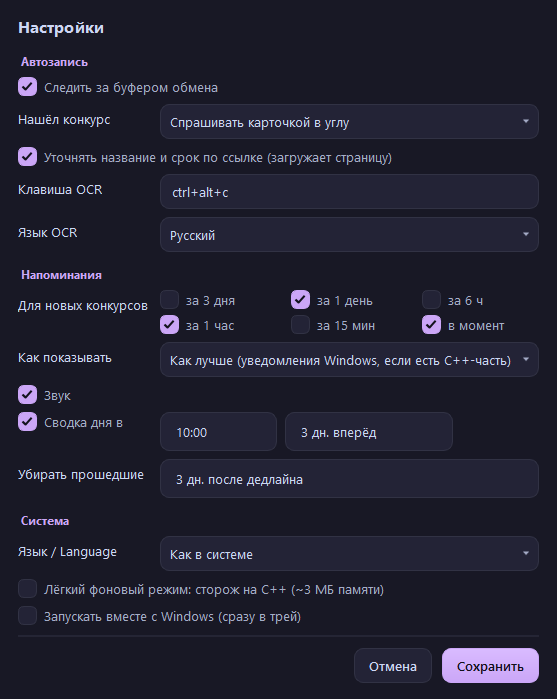
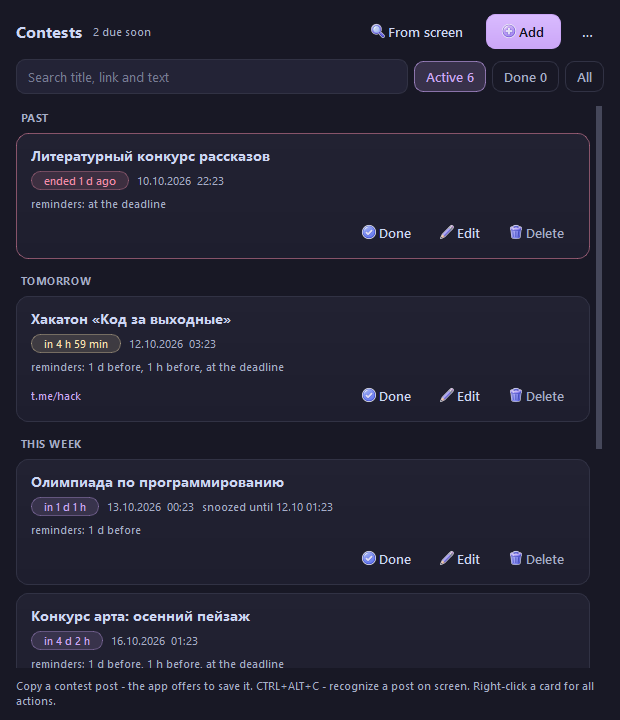

# ContestReminder

**Русский** | [English](README.en.md)

[](https://github.com/moonlivedt-oss/ContestReminderMoon/actions/workflows/tests.yml)


[](LICENSE)



Трей-напоминалка о конкурсах, которая всё делает сама. Конкурсы лень записывать, а в
голове они не держатся, поэтому программа сама ловит пост, находит в нём дедлайн и
напоминает вовремя. Записывать ничего не нужно: достаточно скопировать пост.

## Как попадают конкурсы

| Откуда | Что сделать |
|---|---|
| **Буфер обмена** | Скопировать пост о конкурсе - в углу экрана появится карточка «Сохранить?» |
| **Экран (OCR)** | `Ctrl+Alt+C`, выделить мышью пост-картинку (Telegram, баннер) |
| **Браузер** | Выделить пост на сайте и нажать закладку или `Alt+Shift+C` (userscript) |
| **PowerShell** | `.\tools\cr.ps1 "текст поста"` или `Get-Clipboard \| .\tools\cr.ps1` |
| **Вручную** | Кнопка «Добавить» или «Вставить из буфера» в меню «…» |

Всё найденное идёт одним путём:

1. **Разбор текста.** Заголовок (первая фраза, без эмодзи и хэштегов), ссылка (и без
   `https://`: `vk.com/...`, `t.me/...`), дедлайн. Дат в посте обычно несколько
   («старт 1 октября, приём до 15-го, итоги 20-го»), поэтому выбирается та, перед которой
   стоят «до», «дедлайн», «ends», «bis», а даты после «с», «старт» и «итоги» отбрасываются.
2. **Дубли.** Тот же конкурс (та же ссылка без utm-меток или почти то же название) второй
   раз не предлагается. Если в новом посте другой срок, карточка предложит обновить его.
3. **Страница по ссылке.** Если в посте нет срока или название слишком общее, программа
   сама откроет ссылку в фоне и возьмёт их со страницы. Посты `t.me/канал/123` читаются
   без входа.
4. **Сохранение.** По умолчанию в углу появляется карточка «Сохранить / Изменить / Не надо».
   В настройках можно включить «сохранять сразу» (с кнопкой «Отменить») или открывать
   окно правки.

Обычные копирования не мешают: одна дата без слова «конкурс» и без ссылки карточку не
вызывает.

### Какие даты понимает

| Язык | Примеры |
|---|---|
| Русский | `до 15 сентября в 18:00`, `20.09.2026`, `с 1 по 15 ноября`, `завтра`, `до пятницы`, `до конца месяца`, `осталось 3 дня` |
| Украинский | `до 25 листопада о 18:00`, `до п'ятниці`, `сьогодні`, `до кінця тижня`, `залишилось 5 днів` |
| Английский | `ends September 30`, `deadline Nov 20, 2026`, `tomorrow`, `until Friday`, `in 5 days` |
| Немецкий | `Einsendeschluss 15. November 2026 um 18:30`, `bis Freitag`, `übermorgen`, `Ende des Monats`, `noch 3 Tage` |

Год без указания - ближайший будущий; без времени - 23:59.

## Напоминания



- У каждого конкурса свой набор порогов: за 3 дня / 1 день / 6 ч / 1 час / 15 мин / в момент.
- Напоминание - **уведомление Windows** с кнопками **Открыть** (ссылку), **Через 1 ч**,
  **Завтра** и **Готово**. Оно остаётся в Центре уведомлений, если вы отошли, а срочные висят на
  экране, пока не нажмёте. Кнопки работают, даже когда программа закрыта.
  Без C++-части (запуск из исходников без MSVC) - карточка программы с кнопками **Открыть**,
  **Отложить** (15 мин, 1 ч, 3 ч, до завтра 9:00) и **Готово**, со звуком.
- Программа была выключена и пропустила несколько порогов - придёт одно напоминание, самое
  срочное, а не пачка.
- **Сводка дня** в заданное время: что заканчивается в ближайшие дни.
- Прошедшие конкурсы через несколько дней (по умолчанию 3) сами уходят в «Выполненные».

## Окно

- Группы по сроку: «Прошли», «Сегодня», «Завтра», «На этой неделе», «Позже», «Без срока».
- Поиск по названию, ссылке и тексту поста; фильтры «Активные / Выполненные / Все».
- Клик по названию открывает ссылку; правый клик по карточке - все действия: открыть,
  копировать ссылку, уточнить по ссылке, отложить, добавить в календарь, изменить, удалить.
- Удаление без вопросов, но с кнопкой «Вернуть».
- В трее: ближайшие дедлайны, в подсказке значка - ближайший.
- Меню «…»: экспорт в календарь (`.ics` открывается Outlook, Google Календарём и
  Календарём Windows), резервная копия и восстановление, закладка для браузера, язык,
  настройки.



### Языки интерфейса

Русский, английский, украинский и немецкий; по умолчанию - как в Windows. Переключается
сразу, без перезапуска: меню «…» -> «Язык» или в настройках.



## C++: уведомления Windows и лёгкий сторож

`native/crnative.cpp` - нативная часть на C++20 и C++/WinRT (около 400 КБ, без сторонних
библиотек). Она входит в `ContestReminder.exe` и ставится в `%LOCALAPPDATA%\ContestReminder\bin`.

- **Уведомления Windows.** Программа отдаёт напоминание crnative, тот показывает его через
  Центр уведомлений. Кнопки - адреса `contestreminder://snooze?id=...`: Windows запускает по ним
  crnative, а он передаёт действие программе через мост или, если она закрыта, сам правит
  `contests.json` (под общим мьютексом, атомарной записью).
- **Лёгкий фоновый режим** (настройки -> Система). Обычно программа живёт в трее целиком
  (Python и Qt). В лёгком режиме закрытие окна выключает её, а напоминает сторож
  `crnative watch`: около 3 МБ личной памяти и 0,2 МБ рабочего набора в покое. Он спит до
  ближайшего порога, просыпается при изменении `contests.json` и молчит, пока запущена
  основная программа. Окно открывается кликом по уведомлению. Автозапуск с Windows в этом
  режиме запускает сторожа, а не программу.

Сборка из исходников (нужны Visual Studio или Build Tools с компонентом C++ и Windows SDK):

```bat
native\build.cmd                         :: -> native\bin\crnative.exe
native\bin\crnative.exe selftest out.txt :: самопроверка: даты, JSON, пороги, XML уведомления
```

Нет MSVC - программа работает и без C++-части: карточки вместо уведомлений Windows, без
сторожа.

## Браузер и PowerShell

Программа слушает локальный мост `127.0.0.1:47615` (только этот компьютер). Каждый запрос
должен нести секретный ключ из настроек, иначе он отклоняется. Присланное не сохраняется
молча, а появляется той же карточкой «Сохранить?».

- **Закладка:** меню «…» -> «Браузер: скопировать закладку», создать закладку и вставить
  скопированное в поле «Адрес». На странице выделить пост и нажать закладку.
- **Userscript** (`browser/contestreminder.user.js`, JavaScript): меню «…» -> «Браузер:
  сохранить userscript…» - программа подставит ключ. Установить в Tampermonkey или
  Violentmonkey; на странице `Alt+Shift+C` или пункт меню расширения.
- **PowerShell** (`tools/cr.ps1`): берёт ключ из `%APPDATA%\ContestReminder\settings.json`.

```powershell
.\tools\cr.ps1 -Ping
.\tools\cr.ps1 "Конкурс артов до 30 ноября https://example.com/art"
Get-Clipboard | .\tools\cr.ps1
```

## Установка и запуск

**Проще всего** - скачать `ContestReminder.exe` со страницы
[Releases](https://github.com/moonlivedt-oss/ContestReminderMoon/releases/latest) и запустить:
Python не нужен, рядом лежит `ContestReminder.exe.sha256` для проверки. Файл собирает
GitHub Actions и перед выкладкой прогоняет самопроверку.

**Из исходников** (Windows 10/11): скачайте репозиторий (Code -> Download ZIP или
`git clone`) и дважды щёлкните **`Запуск.bat`**. Он всё настроит сам:

1. найдёт Python 3.11 или 3.12 (через `py` или `python` в PATH);
2. если Python нет - предложит поставить 3.11 через `winget`;
3. при первом запуске поставит пакеты из `requirements.txt` (`PyQt6`, `mss`, `winsdk`,
   `Pillow`; нужен интернет, один раз);
4. запустит программу без окна консоли.

Python 3.13+ не подходит: под него нет пакета `winsdk` (Windows OCR). Вторая копия
программы не запускается, а показывает окно уже работающей.

Окно живёт в трее: закрытие сворачивает его, выход - правый клик по значку -> «Выход».
**Автозапуск с Windows** включается в настройках: программа стартует при входе сразу в
трей (строка в `HKCU\...\Run`, права администратора не нужны).

Данные: `%APPDATA%\ContestReminder\` (`contests.json`, `settings.json`). Запись атомарная,
битый файл не затирается, а откладывается рядом как `*.broken.json`.

Для разработки:

```powershell
py -3.11 -m pip install -r requirements.txt pytest ruff
py -3.11 run.pyw            # ключ --tray - стартовать свёрнутым в трей
py -3.11 -m pytest          # 61 тест: парсер на 4 языках, дубли, календарь, мост, переводы
py -3.11 -m ruff check .
py -3.11 run.pyw --selftest # самопроверка: OCR, значки, Qt, парсер, переводы
```

Свой exe: **`Собрать exe.bat`** (C++-часть через `native\build.cmd`, затем PyInstaller по
`ContestReminder.spec`, в конце - самопроверка готового файла). Релиз: `gh release create vX.Y.Z` - workflow `release.yml`
соберёт exe и приложит его к релизу.

## Требования к системе

- Windows 10/11 с языковыми пакетами OCR (ru, en) - обычно уже стоят. Если OCR ругается,
  добавьте язык в «Параметры -> Время и язык -> Язык».
- Горячая клавиша регистрируется глобально; если она занята, смените её в настройках или
  вызывайте распознавание кнопкой «С экрана».

## Структура

```
contestreminder/
  parser.py          текст -> заголовок, ссылка, дедлайн (RU, UK, EN, DE)
  dedupe.py          поиск дублей по ссылке и названию
  enrich.py          страница по ссылке: название и срок (фоновая загрузка)
  reminders.py       пороги, «Отложить», сводка дня, автозакрытие
  models.py          модель конкурса и форматтеры сроков
  config.py          %APPDATA%: настройки, конкурсы, резервные копии
  ics.py             экспорт в календарь (RFC 5545)
  bridge.py          локальный мост для браузера и PowerShell, закладка
  toast.py           карточки в углу экрана с кнопками
  app.py             окно, трей, связывание всего
  editor.py          окно правки конкурса («По ссылке» - заполнить со страницы)
  settings_dialog.py настройки
  i18n.py, locales.py языки интерфейса
  clipboard_watch.py, hotkey.py, region.py, ocr.py   буфер, клавиша, выбор области, Windows OCR
  single_instance.py одна копия программы
  autostart.py       автозапуск с Windows
  native.py          связь с crnative.exe: установка, уведомления, сторож
  selftest.py        самопроверка сборки (--selftest)
  theme.py, icons.py, assets/   оформление и значки
browser/contestreminder.user.js   userscript (JavaScript)
tools/cr.ps1                      отправка из PowerShell
native/crnative.cpp, build.cmd    C++: уведомления Windows и сторож
tests/                            pytest
Запуск.bat                        установка и запуск двойным кликом
Собрать exe.bat, ContestReminder.spec   сборка ContestReminder.exe
```

## Лицензия

Код - [MIT](LICENSE). Значки в `contestreminder/assets/` взяты из библиотеки автора
[photosMOONprojects](https://github.com/moonlivedt-oss/photosMOONprojects) (набор «Фиолетовая ночь»)
и под MIT не попадают. Баги и идеи - в Issues репозитория.
